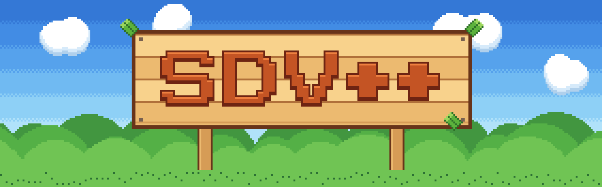
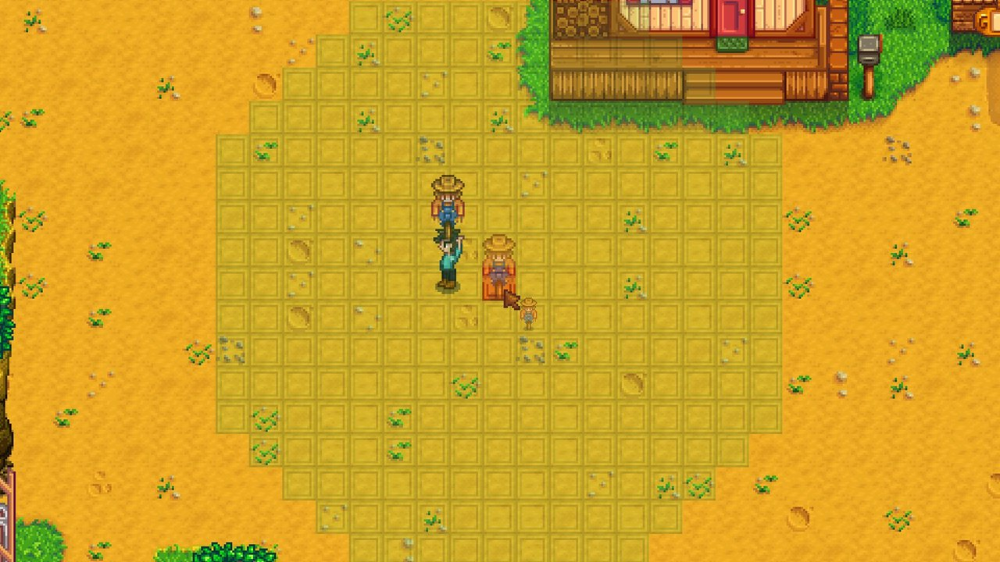
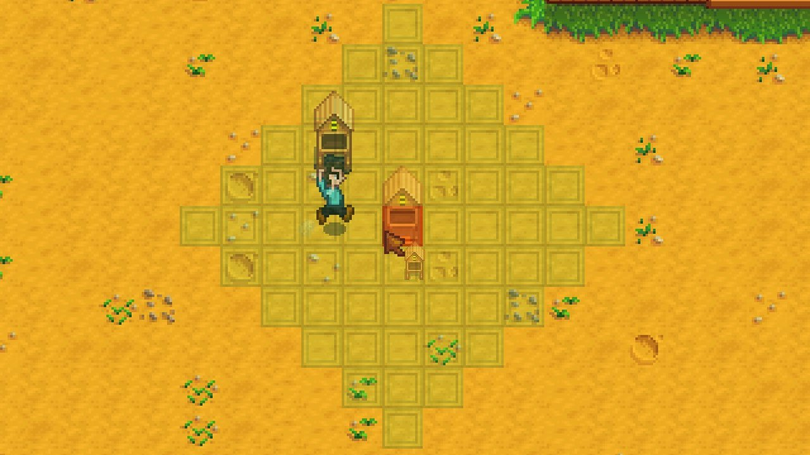
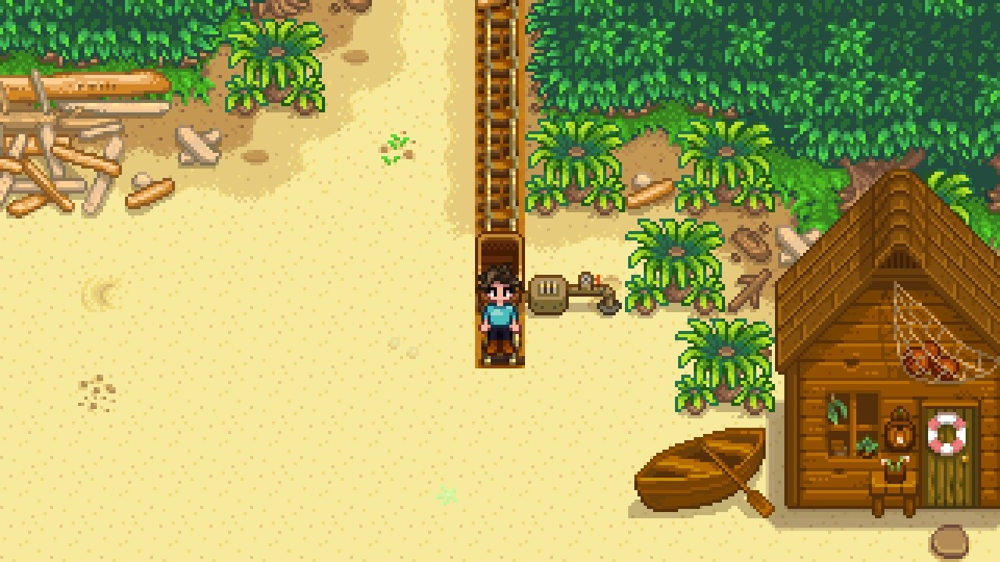
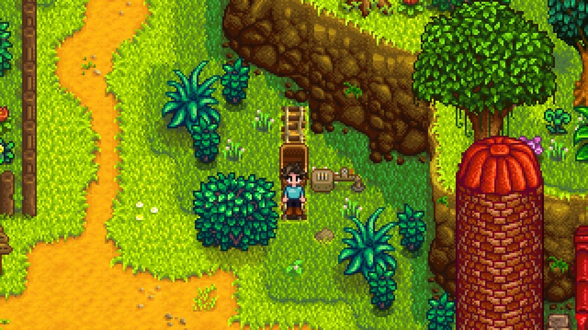
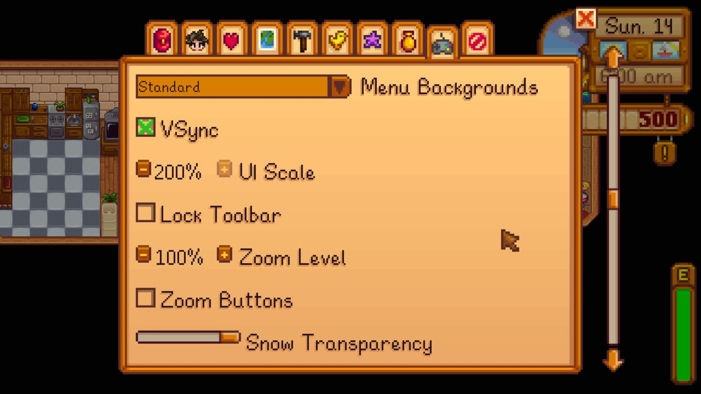

# SDV++

SDV++ is a mod for Stardew Valley 1.6 that adds quality-of-life changes. It works in single-player and in co-op, including split-screen.

## Requirements

- Stardew Valley 1.6.15
- [SMAPI](https://smapi.io) 4.0 or later
- [Content Patcher](https://www.nexusmods.com/stardewvalley/mods/1915) 2.0 or later
- [Generic Mod Config Menu](https://www.nexusmods.com/stardewvalley/mods/5098), optional, to change settings in game

## Installing

Install SMAPI and Content Patcher, then copy the `SDVPP` and `SDVPP.Content` folders into your `Mods` folder. You need both: `SDVPP` is the mod and `SDVPP.Content` is its content pack.

In co-op, every player needs the same version of SDV++.

## Features

Every feature can be turned off. Settings are in `Mods/SDVPP/config.json`, or in `Mods/SDVPP.Content/config.json` for features marked "content pack". Generic Mod Config Menu shows both. In co-op, keep content pack settings the same for every player.

### Farming and shops

- On the last day of spring, summer and fall, Pierre and JojaMart also sell next season's seeds. (`NextSeasonSeeds`, content pack)
- Craft a Quality Sprinkler from a Sprinkler (Farming 6), and an Iridium Sprinkler from a Quality Sprinkler (Farming 9). (`SprinklerUpgradeRecipes`, content pack)
- Robin can upgrade a Silo to a Big Silo that holds 500 hay, then to a Deluxe Silo that holds 750. (`SiloUpgrades`, content pack)
- A sprinkler that reaches the pet bowl's water fills it every morning. (`SprinklersFillPetBowl`, host's setting)
- You can refill your watering can at the Pelican Town fountain, except in winter. (`FountainWater`, content pack)
- When you hold or place a sprinkler, scarecrow, bee house or Junimo hut, or point at one, SDV++ highlights the tiles it covers. (`RangePreview`)

### Villagers

- Mayor Lewis sends a letter the day before your wedding. The ceremony starts as soon as you wake up, so this is your chance to change clothes. (`WeddingReminder`)
- Mayor Lewis writes to ask for your birthday. On the day, some villagers wish you a happy birthday, your spouse congratulates you, and friends at 4 or more hearts send a letter with a small gift. Your birthday also shows on the calendar. To check, change or clear it, use `sdvpp_birthday` in the SMAPI console. (`PlayerBirthday`)

### Storage

- The log pile next to the farmhouse door stores Wood and Hardwood. The whole farm shares it, and one player can use it at a time. (`WoodShelterStorage`)
- Unused fishing tackle stacks. A fishing rod still takes one per slot. (`StackUnusedTackle`; every player should use the same setting)
- When you craft on the farm or in a farmhouse, Wood and Hardwood in the log pile count as ingredients. (`CraftWithShelterWood`)
- Robin's buildings and house upgrades can use Wood and Hardwood from the log pile. While Robin's building menu is open, other players see the log pile as in use. (`BuildWithShelterWood`)

### Fewer accidents

- The game asks before a warp totem or the Return Scepter sends you away. (`ConfirmWarpTotems`, `ConfirmReturnScepter`)
- Clicking a crop or forage while you hold food doesn't ask whether you want to eat it. (`NoEatPromptOnCrops`)
- Opening a door while you hold an item doesn't hand it to a villager standing just below the door. (`NoGiftsThroughDoors`)

### Decorating

- Time stops at home while you hold a piece of furniture, so you can decorate without losing the day. Set `DecoratingTimeFreeze` to `HoldingFurniture` (default), `AnywhereAtHome` or `Off`. In co-op the host's setting applies, and the clock only stops when every player is decorating at home.
- Robin can paint silos, including Big and Deluxe Silos. You can color the walls, the dome and the ring under the dome separately. (`SiloPainting`, content pack)

### Travel

- Minecart stops in Cindersap Forest, near the farm, and on the Beach, at the end of the path from town. They join the existing network after the Boiler Room is repaired. (`MinecartStops`, content pack)

### Interface

- The title screen skips the intro and shows its buttons right away. The slide to New, Load and Co-op takes 700 ms; change it with `TitleSlideMilliseconds` (0 keeps the game's speed). (`FastTitleScreen`)
- The title, load, co-op and character creation screens use your in-game UI scale instead of 100%. Set `TitleUiScale` to a percentage to override it.
- The options menu offers UI scales up to the largest that fits your screen (200% at 2560x1440) and zoom up to 250%. (`ExtendedScaleRanges`)
- Menus work with the keyboard: arrow keys move, Enter or Space clicks, Backspace right-clicks, number keys pick an answer to a question, and Escape goes back on the title screen. (`KeyboardMenus`)
- The fade between locations is twice as fast. Sleeping and cutscenes keep their usual pace. (`FadeSpeed`, 1 for the game's speed)

## Screenshots

| | |
|---|---|
|  |  |
| The area a scarecrow protects, shown while you place it | The area a bee house looks for flowers in |
|  |  |
| The minecart stop at the bottom of the path from town | The Forest stop, a short walk from the farm |
|  | |
| The options menu at 200% UI scale | |

## Known limitations

- Each sprinkler upgrade recipe you know counts toward Craft Master and Perfection, so you need to craft each one once.
- Big and Deluxe Silos look like a regular silo.
- Turning off `SiloUpgrades` or removing SDV++ leaves upgraded silos without building data.
- Chopped wood isn't stored in the log pile automatically. After the second farmhouse upgrade the log pile is drawn as part of the porch, but it still works.
- The new minecart stops have no steam puff.
- If you remove SDV++, stacks of tackle shrink to one item the next time the game moves them, and the rest are lost.
- The zoom buttons next to the clock still stop at 200%. Use the options menu for higher zoom.
- Crafting with log pile wood works only on the farm or in a farmhouse or cabin, and not for cooking. While someone crafts there, other players see the log pile as in use.
- Birthday greetings come from Lewis, Evelyn, Gus, Robin, Pierre, Marnie, Linus, Willy, Clint, the Wizard, Penny and Vincent. Letters come from your mom or dad, Lewis, Evelyn, Gus and Robin.

## Building from source

You need the .NET 6 SDK or later and an installed copy of the game.

```bash
dotnet build             # builds the mod and copies it to the game's Mods folder
dotnet build -c Release  # writes a release zip to ./release
```

`tools/link-content.sh` links the content pack into the game's `Mods` folder, so content changes apply after `patch reload Luke.SDVPP.Content` in the SMAPI console. `tools/check-version.sh` checks that the project and both manifests have the same version.

## License

SDV++ is licensed under the GNU AGPL v3.0. See [LICENSING.md](LICENSING.md).
